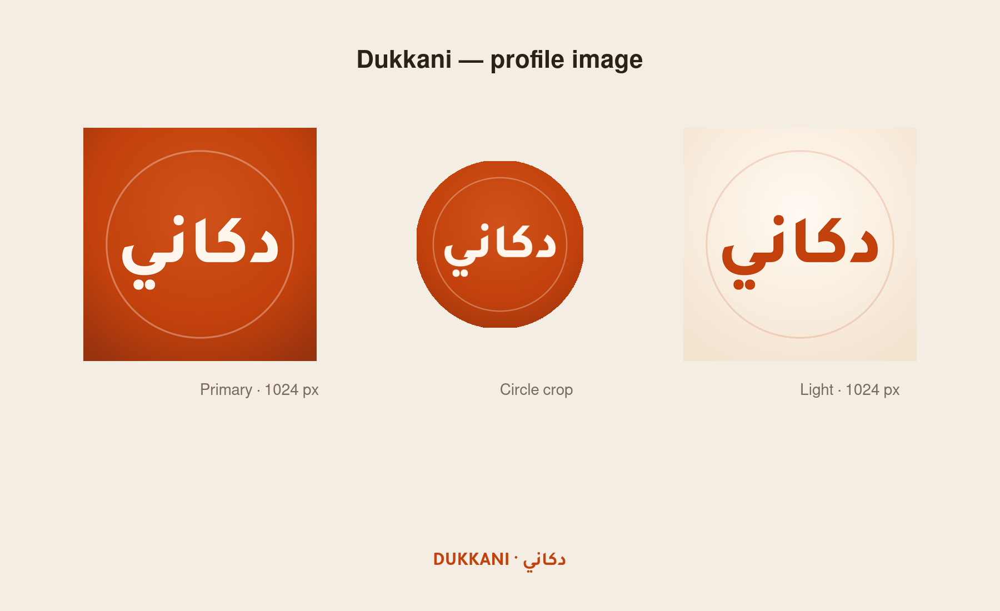

# Dukkani — profile image

A warm, Arabic-first avatar for **Dukkani (دكاني)**, built from the landing page palette. The wordmark is the brand name itself, so it reads clearly even at WhatsApp/Instagram avatar size.



## Recommended

**`dukkani-profile-light-1024.png`** — the light version you chose. Upload this one to Instagram, WhatsApp Business, Facebook, LinkedIn, TikTok, or X.

The design is square and **circle-safe**: the wordmark and inner ring stay inside the platform's circular crop. The terracotta version (`dukkani-profile-1024.png`) is included as a bolder alternate.

## On the website

The light version is wired into `dukkani-landing/index.html`:

- Favicon: `dukkani-landing/assets/favicon-light.svg` + `favicon-light-32.png`
- Apple touch icon: `dukkani-landing/assets/dukkani-profile-light-180.png`
- Social share card: `dukkani-landing/assets/dukkani-og.png` (1200 × 630)
- Source image: `dukkani-landing/assets/dukkani-profile-light.png`

The header keeps the existing **د** mark + wordmark; using the square avatar there would duplicate the name. Deploy the `dukkani-landing` folder to publish the new icons and share card.

## Files

| File | What it is |
|---|---|
| `dukkani-profile-1024.png` | Primary avatar, 1024 × 1024, sRGB. |
| `dukkani-profile-512.png` | Smaller primary avatar. |
| `dukkani-profile-256.png` | Small primary avatar. |
| `dukkani-profile-light-1024.png` | Light version on cream, for white/light layouts. |
| `dukkani-profile-light-512.png` | Smaller light version. |
| `dukkani-profile-circle-1024.png` | Primary avatar with transparent corners, ready for circular placements. |
| `dukkani-profile.svg` | Primary vector source. Text is outlined, so it needs no fonts. |
| `dukkani-profile-light.svg` | Light vector source. Text is outlined. |
| `preview.png` | This contact sheet. |

## Palette

| Role | Hex |
|---|---|
| Terracotta (primary) | `#c2410c` |
| Deep terracotta | `#96320f` |
| Warm highlight | `#d0521a` |
| Cream (wordmark) | `#fff7ee` |
| Page cream | `#fffaf3` → `#f3e2cd` |

Type: **Tajawal ExtraBold** for the wordmark. The SVGs have the word converted to paths, so they render the same on any machine.

## Rebuild the PNGs

```bash
cd brand
rsvg-convert -w 1024 -h 1024 dukkani-profile.svg -o dukkani-profile-1024.png
rsvg-convert -w 512  -h 512  dukkani-profile.svg -o dukkani-profile-512.png
rsvg-convert -w 256  -h 256  dukkani-profile.svg -o dukkani-profile-256.png
rsvg-convert -w 1024 -h 1024 dukkani-profile-light.svg -o dukkani-profile-light-1024.png
```

## Notes

- **دكاني** means “my shop” — the name is intentionally shown in Arabic first.
- The light version is for places where the terracotta tile feels too heavy, such as a white website header or a LinkedIn banner.
- The thin ring is decorative. It sits well inside a circular crop; no important detail is near the edges.
- If you need an English-first lockup, a monogram/icon version, or a banner to match, ask and it can be added to this folder.
