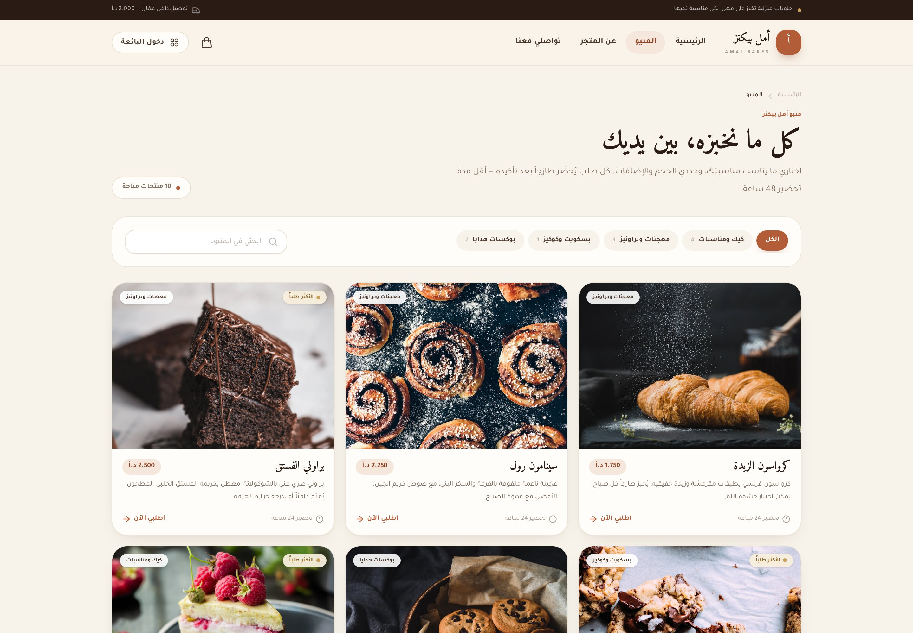

# Dukkani — Amal Bakes demo

An Arabic-first storefront and seller dashboard for **أمل بيكنز / Amal Bakes**, a home bakery in Amman. This is the working demo of Dukkani: a real Laravel application with a seeded store, real order data, and a multi-tenant-ready schema — not a mockup.

The public storefront and seller dashboard were built in milestones. Current status: **Milestone 6 complete** (storefront, cart, checkout, tracking, orders workflow, product catalog, customer book, store settings, analytics, and a Render deployment setup with a portfolio case study).

Live demo: **https://dukkani-demo.onrender.com** (see [`docs/DEPLOYMENT.md`](../docs/DEPLOYMENT.md) to deploy your own copy).

## Stack

| Layer | Choice |
|---|---|
| Backend | Laravel 12 (PHP 8.4+) |
| Views | Blade + Tailwind CSS 4 + Alpine.js |
| Build | Vite 7 |
| Database | SQLite (demo), integer fils for money |
| Language | Arabic only, RTL |
| Hosting target | Render |

No registration, billing, admin panel, payment gateway, or WhatsApp API. WhatsApp actions use `wa.me` links with a placeholder number.

## Demo access

The root URL `/` redirects to the live storefront. The seller dashboard is at `/login`.

- Storefront: `http://localhost:8000/s/amal-bakes`
- Dashboard URL: `http://localhost:8000/login`
- Email: `demo@dukkani.jo`
- Password: `demo1234`
- Or use **دخول سريع إلى لوحة التحكم** (one-click demo login).

All data is sample data. The storefront, dashboard, and login screen label the demo clearly.

## Local setup

```bash
cd dukkani-app

composer install
npm install

cp .env.example .env
php artisan key:generate

touch database/database.sqlite
php artisan migrate --seed
php artisan storage:link

npm run build
php artisan serve
```

The seed creates:

- 1 store — Amal Bakes, Amman
- 10 products across 4 categories, with options and price deltas
- 14 customers with Amman neighborhoods and tags
- 32 orders across every workflow status, including today's schedule
- Deposits, order events, notifications, WhatsApp logs, blocked dates, store hours

To refresh the demo data at any time:

```bash
php artisan migrate:fresh --seed
```

## What is built

- [x] Laravel 12 project, SQLite, Arabic locale, Asia/Amman timezone
- [x] Multi-tenant-ready migrations (`store_id` on every tenant table)
- [x] Enums, models, relationships, money helpers
- [x] Cart, order, WhatsApp, and analytics services
- [x] Realistic Amal Bakes demo seed
- [x] Arabic login + one-click demo login
- [x] Seller dashboard shell, KPIs, revenue chart, today's schedule, recent orders, notifications
- [x] Public storefront home, full menu, product pages with options
- [x] Session cart (add, update, remove, clear) with live totals
- [x] Checkout with schedule picker (lead time, store hours, blocked dates), delivery/pickup, payment + deposit
- [x] Public order confirmation & tracking page
- [x] Orders board (list + kanban board) with status tabs, search, date/fulfillment/payment filters, sorting, pagination
- [x] Order detail and workflow: status transitions, deposit tracking, internal notes, WhatsApp templates + message log, activity timeline
- [x] Dashboard links into the orders board; notification dropdown opens orders and marks them read
- [x] Products: list/grid, search and filters, create/edit with image upload or URL, option builder, availability toggle, soft delete, category manager
- [x] Customers: searchable customer book with tags, lifetime spend, order counts, profile page and editable notes/tags
- [x] Settings: store profile, logo/cover, storefront link, delivery/pickup, deposit rules, lead time, working hours, blocked dates
- [x] Analytics: period comparison, revenue trend, status/fulfillment/payment breakdowns, top products and customers, busiest days
- [x] Arabic copy and RTL pass, custom favicon, final test coverage
- [x] Self-hosted Amiri + Tajawal fonts and local bakery photos (no external asset dependencies)
- [x] Production Docker image, `render.yaml` Blueprint (Render free tier), and a deploy entrypoint
- [x] Screenshot suite, portfolio case study (English + Arabic), and a paste-ready portfolio card

## Storefront and checkout

- `GET /` — redirects to the active storefront.
- `GET /s/{store}` — storefront home (hero, categories, featured products, about, hours, contact).
- `GET /s/{store}/menu` — full menu with server-side `?category=` and `?q=` filtering.
- `GET /s/{store}/product/{product}` — product page with options, price deltas, quantity, notes.
- `GET /s/{store}/cart` — session cart with quantity controls and order summary.
- `POST /s/{store}/cart` — add an item; `PATCH`/`DELETE /s/{store}/cart/{key}` update/remove.
- `GET|POST /s/{store}/checkout` — customer details, delivery/pickup, schedule, payment.
- `GET /orders/{order:public_token}` — public confirmation and tracking (no login needed).

Scheduling rules (lead time, opening hours, blocked dates, 30-minute slots) are centralized in `App\Services\ScheduleService` and validated on the server, not just in the browser.

## Orders board and workflow

All routes require login and are scoped to the authenticated user's store.

- `GET /dashboard/orders` — orders board. `?view=list|board`, `?status=`, `?q=`, `?date=`, `?fulfillment=`, `?payment=`, `?sort=`.
  - **List** view: status tabs with counts, filters, sorting, 12-per-page pagination.
  - **Board** view: kanban columns for every status (جديد → تم التسليم), capped at 240 cards.
- `GET /dashboard/orders/{order}` — order detail: workflow stepper, quick status actions, items and totals, customer card, deposit card, WhatsApp templates, internal notes, and the full activity timeline.
- `PATCH /dashboard/orders/{order}/status` — move an order to one of its allowed next statuses (`OrderService::transition`).
- `PATCH /dashboard/orders/{order}/deposit` — set the deposit to paid, refunded, or pending.
- `PATCH /dashboard/orders/{order}/notes` — save internal notes.
- `POST /dashboard/orders/{order}/messages` — log an opened WhatsApp template (`MessageLog` + order event).
- `POST /dashboard/notifications/read` — mark all notifications read; `POST /dashboard/notifications/{notification}` opens the related order.

Status transitions are validated against `OrderStatus::nextStatuses()`, so an illegal jump (for example جديد → تم التسليم) is rejected on the server. Every action appends an `OrderEvent`, and status/deposit changes raise in-app notifications.

## Products, customers and settings

All routes require login and are scoped to the authenticated user's store.

### Products

- `GET /dashboard/products` — catalog grid with stat cards, status tabs (الكل / متاحة / مخفية), search, category filter, sorting, pagination, and a category manager (add/delete).
- `GET /dashboard/products/create` — product form: name, slug, description, price, category, lead time, image upload or URL, availability, featured flag, and a dynamic option builder (single/multiple choice, required, price deltas).
- `GET /dashboard/products/{product}/edit` — same form prefilled, plus delete.
- `POST /dashboard/products` — create; options and values are written in one transaction.
- `PATCH /dashboard/products/{product}` — update; options are replaced atomically.
- `PATCH /dashboard/products/{product}/availability` — toggle storefront visibility.
- `DELETE /dashboard/products/{product}` — soft delete (order item snapshots are kept).
- `POST /dashboard/products/categories` / `DELETE .../categories/{category}` — manage the store's categories; deleting one leaves its products uncategorized.

Product slugs are made unique automatically, category ownership is validated, and hidden products disappear from the public menu.

### Customers

- `GET /dashboard/customers` — customer book with search, tag filter, sorting (last order / spend / order count / name), order count, lifetime spend, last order, and tags.
- `GET /dashboard/customers/{customer}` — profile: stats, full order history linked to the order detail, quick call/WhatsApp, and an edit form for name, phone, email, address, notes, and tags.
- `PATCH /dashboard/customers/{customer}` — update; phone uniqueness is scoped to the store, and tags accept Arabic or Latin commas.

### Settings

- `GET /dashboard/settings?tab=profile|delivery|hours` — store profile, images, delivery/payment rules, working hours, and blocked dates.
- `PATCH /dashboard/settings/profile` — name, slug, tagline, description, contact details, location, logo and cover (upload, URL, or remove).
- `PATCH /dashboard/settings/store` — pickup/delivery toggles, delivery fee, deposit percentage, store lead time, and deposit instructions. At least one fulfillment method must stay enabled.
- `PATCH /dashboard/settings/hours` — seven-day opening hours; closed days are stored without times.
- `POST /dashboard/settings/blocked-dates` / `DELETE .../{blockedDate}` — add or remove blocked dates (today or later).

Uploads use Laravel's `public` disk, so run `php artisan storage:link` once during setup.

## Analytics

- `GET /dashboard/analytics` — analytics dashboard. `?period=7|30|90` sets the window (default 30), and `?sort=revenue|sold` re-ranks top products.
- KPI cards compare the selected period with the preceding one: delivered revenue, orders, average order value, and active customers.
- Charts cover the daily revenue trend, order-status mix, orders by weekday, fulfillment split, and payment-method split.
- Tables list the top five products (by revenue or quantity) and the top five customers by delivered spend, with links into the customer profile.
- All metrics are computed in `AnalyticsService` and scoped to the authenticated user's store. Revenue counts delivered orders only, while order-based counters exclude cancelled orders.

## Screenshots

The full gallery (27 shots, desktop + mobile, 2x) lives in
[`docs/screenshots`](../docs/screenshots) and is regenerated with a Playwright
script:

```bash
NODE_PATH=/path/to/node_modules BASE_URL=http://127.0.0.1:8000 \
  TRACK_TOKEN=<public order token> ORDER_ID=1 CUSTOMER_ID=1 PRODUCT_ID=1 \
  node scripts/capture-screenshots.cjs
```

| Storefront | Menu | Product | Cart |
|---|---|---|---|
|  |  |  |  |

| Checkout | Tracking | Dashboard | Orders board |
|---|---|---|---|
|  |  |  |  |

| Products | Customers | Analytics | Settings |
|---|---|---|---|
|  |  |  |  |

| Storefront (mobile) | Dashboard (mobile) | Analytics (mobile) |
|---|---|---|
|  |  |  |

## Assets

All external assets are vendored locally so the demo has no runtime dependency on
Unsplash or Google Fonts:

- **Photos:** 11 bakery photos plus a placeholder SVG in `public/images/amal-bakes/`.
- **Fonts:** Amiri (display) and Tajawal (UI), self-hosted as woff2 in
  `resources/fonts/` and imported from `resources/css/fonts.css`; Vite resolves
  and hashes them into `public/build/assets/`.
- **Credits:** see [`docs/CREDITS.md`](../docs/CREDITS.md).

## Deployment

The demo ships as a production Docker image and deploys to
[Render](https://render.com) from the repository's `render.yaml` Blueprint
(free plan by default; add a disk and a paid instance to persist data). It is
live at **https://dukkani-demo.onrender.com**.

- `dukkani-app/Dockerfile` — multi-stage build (Vite assets → Composer vendor →
  `php:8.4-apache`).
- `dukkanni-app/docker/entrypoint.sh` — prepares storage, generates and
  stores `APP_KEY`, runs migrations, seeds the demo once, caches config/routes/views,
  and starts Apache on Render's `$PORT`.
- `dukkanni-app/docker/apache.conf`, `dukkanni-app/docker/php.ini` — vhost and
  production PHP settings.
- `.env.production.example` — the production environment reference.

The step-by-step guide is in [`docs/DEPLOYMENT.md`](../docs/DEPLOYMENT.md).

## Architecture notes

- **Multi-tenant ready:** every tenant table carries `store_id`; dashboard queries scope through the authenticated user's store.
- **Money:** stored as integers in fils (`1 JOD = 1000 fils`) and formatted by `App\Support\Money`.
- **Statuses:** `OrderStatus`, `FulfillmentType`, `DepositStatus`, and `PaymentMethod` are PHP enums.
- **Services:** `CartService` (session cart), `OrderService` (placement, transitions, deposits, notes, message logging), `ScheduleService` (lead time, hours, blocked dates, slots, validation), `WhatsAppService` (templates), `AnalyticsService` (period KPIs, trends, breakdowns, top products/customers).
- **Demo mode:** `DEMO_MODE=true` enables the one-click login and sample-data labels.
- **Business rules seeded:** 30% deposit for CliQ/bank transfers, 2 JOD delivery, 48-hour store lead time (72-hour max across products), pickup free.

## Tests

```bash
php artisan test
```

The feature tests cover the storefront (home, menu filtering, product options, cross-store isolation), the session cart (add/update/remove, required options), checkout (schedule validation, blocked dates, lead time, delivery vs. pickup, deposits, cart clearing), public tracking, the milestone 1 auth/dashboard flow, the orders board and workflow (listing, status/search/filters, board view, cross-store isolation, status transitions, deposits, notes, WhatsApp logging, notifications), the product catalog (create/update with options, availability, categories, hidden products), the customer book (search, tags, profile, notes, scoped phone uniqueness), store settings (profile, delivery rules, hours, blocked dates, cross-store isolation), and analytics (period filtering, comparisons, top-product ranking, breakdowns, cross-store isolation). The suite currently has **75 tests and 296 assertions**.

## Docs

- [`docs/CASE_STUDY.md`](../docs/CASE_STUDY.md) — portfolio case study (English)
- [`docs/CASE_STUDY.ar.md`](../docs/CASE_STUDY.ar.md) — portfolio case study (العربية)
- [`docs/PORTFOLIO_CARD.md`](../docs/PORTFOLIO_CARD.md) — paste-ready portfolio entry
- [`docs/DEPLOYMENT.md`](../docs/DEPLOYMENT.md) — Render deployment guide
- [`docs/CREDITS.md`](../docs/CREDITS.md) — photo and font credits
- [`docs/PROJECT_BRIEF.md`](../docs/PROJECT_BRIEF.md) — scope, milestones, environment notes
- [`dukkani-spec.md`](../dukkani-spec.md) — original product and data-model spec
