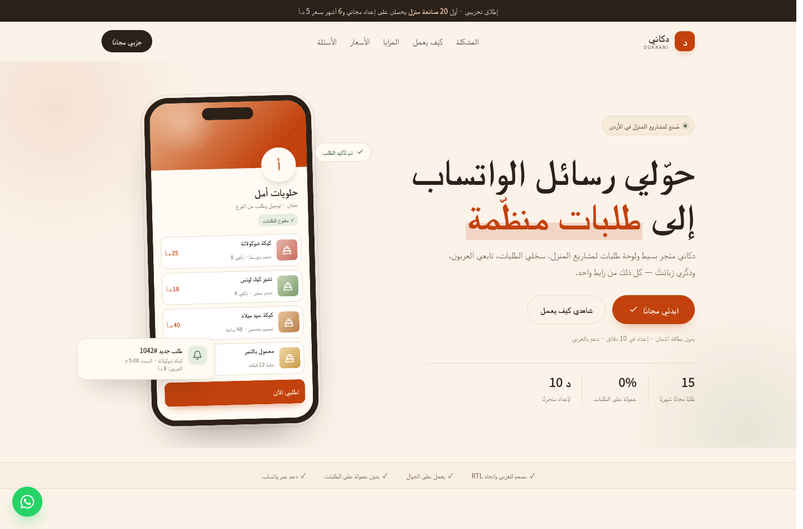
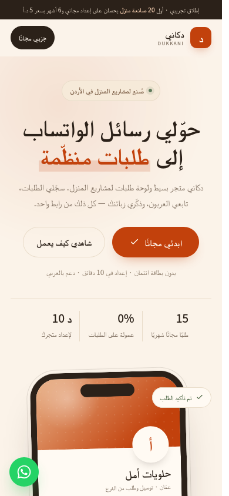

# Dukkani landing page

A single-file, Arabic-first (RTL) landing page for validating the Dukkani idea.

**Live:** https://dukkani-app.netlify.app

**Files**

- `index.html` — the page (HTML + CSS + vanilla JS, no build step).
- `assets/` — light profile image, favicon, Apple touch icon, and 1200×630 social card.
- `preview.png` — desktop preview.
- `preview-mobile.png` — mobile preview.





---

## Preview locally

Open the file directly:

```bash
xdg-open index.html
```

Or serve it:

```bash
python3 -m http.server 8080
# then open http://localhost:8080
```

---

## Deploy

The page is static, so any of these work:

- **Netlify Drop:** drag the folder onto https://app.netlify.com/drop
- **Vercel:** `npx vercel` from this folder
- **GitHub Pages:** push the folder and enable Pages
- **Cloudflare Pages:** connect the repo or upload the folder

Suggested domain: `dukkani.jo` (check availability) or a `*.netlify.app` subdomain for the pilot.

### Updating the live site

The site is deployed manually. Editing `index.html` locally does **not** change the live URL until you redeploy.

1. Open https://app.netlify.com and select the **dukkani-app** site.
2. Go to the **Deploys** tab.
3. Drag the `dukkani-landing` folder (or `dukkani-landing.zip`) onto the deploy drop zone at the bottom of the page.
4. Wait for the deploy status to become **Published**.
5. Hard-refresh the live page (`Ctrl+Shift+R`, or clear the mobile browser cache).

Do **not** use https://app.netlify.com/drop for updates — it creates a new site with a new URL. Use the existing site's **Deploys** tab.

For automatic deploys, push this folder to GitHub and connect the repository in **Site configuration → Build & deploy**. Leave the build command empty and set the publish directory to the folder containing `index.html`.

---

## Connect the waitlist form

The form is connected to Formspree. `WAITLIST_ENDPOINT` in the script at the bottom of `index.html` is set to the live form endpoint. To use a different provider, replace that value with its URL.

The form sends JSON:

```json
{
  "name": "أمل",
  "phone": "+962791234567",
  "phoneCountry": "+962",
  "businessType": "other",
  "businessTypeOther": "شموع معطّرة",
  "instagram": "@amal.bakes",
  "source": "dukkani-landing",
  "submittedAt": "2026-10-26T12:00:00.000Z",
  "_subject": "طلب جديد من دكاني — أمل"
}
```

When the visitor selects **أخرى** (`other`), a text field appears and its value is sent as `businessTypeOther`. For any other type, that field is empty.

### Phone rules

The number is not typed with its country code. The visitor picks the code from a dropdown (default **+962 الأردن**) and types only the rest, so every lead is stored in one international format.

| Visitor picks | Types | Stored as |
|---|---|---|
| `+962` الأردن | `791234567` | `+962791234567` |
| `+962` الأردن | `0791234567` | `+962791234567` |
| `+962` الأردن | `00962791234567` | `+962791234567` |
| `+972` فلسطين | `569991081` | `+972569991081` |

Spaces, dashes and parentheses are stripped. A leading `0` and a repeated country code are removed automatically, so a pasted full number still works.

Jordanian numbers must be 9 digits starting with `7` (`077`/`078`/`079`); other countries accept 6–14 digits. A wrong-length number shows a red error, and changing the country clears it.

The payload contains both the combined number and the chosen code:

```json
{ "phone": "+962791234567", "phoneCountry": "+962" }
```

### Recommended options

1. **Formspree** — easiest; free tier; email notifications.
2. **Tally** — embed a Tally form instead of the native form for more control.
3. **Google Apps Script** — free; append rows to a Google Sheet.
4. **A small Laravel endpoint** — e.g. `POST /api/waitlist` with rate limiting.

If you use Google Apps Script, make sure it accepts `application/json` and returns CORS headers.

---

## What to test

Before spending money on ads, share the page in 3–5 relevant Facebook/WhatsApp communities and send it to 15 home bakers personally.

Track:

| Metric | Target | Why |
|---|---|---|
| Landing → form start | 20%+ | Is the headline clear? |
| Form start → submit | 60%+ | Is the form too long? |
| Submit → WhatsApp conversation | 50%+ | Are leads real? |
| Conversation → pilot | 30%+ | Is the offer compelling? |
| Pilot → paid | 60%+ | Will they pay? |

The last number is the only one that matters for the build decision.

---

## Copy variants to test

Change the hero headline and measure signups:

1. **حوّلي رسائل الواتساب إلى طلبات منظّمة** (current)
2. **متجرك ودفتر طلباتك في رابط واحد**
3. **لا تخسري طلبًا في الرسائل بعد اليوم**
4. **من رسالة واتساب إلى طلب مؤكد — بضغطة**

Change one thing at a time. Use two URLs (`?v=1`, `?v=2`) and compare.

---

## Things to replace before launch

- [ ] Custom domain (`dukkani.jo`)
- [x] Contact email (`mohannadjarad6@gmail.com`)
- [ ] Brand name if "Dukkani" is taken
- [x] Logo/avatar (light profile image in `../brand/`; favicon and Apple touch icon in `assets/`)
- [ ] Privacy policy and terms links
- [x] Real WhatsApp number for support (`+972 56 999 1081`)
- [x] Waitlist endpoint (Formspree)
- [ ] Analytics (Plausible, Umami, or GA4)
- [x] Open Graph image (`assets/dukkani-og.png`, 1200×630)
- [x] Favicon (light SVG + 32px PNG)

---

## Contact

- Founder: Mohannad Jarad
- Email: `mohannadjarad6@gmail.com`
- WhatsApp: `+972 56 999 1081`
- The page includes a floating WhatsApp button and a footer contact link.

---

## Notes

- The page uses Google Fonts (Tajawal, Fraunces, Inter). If you need offline/local hosting, download the fonts and self-host them.
- The phone and dashboard mockups are pure CSS/SVG — no images needed.
- The page respects `prefers-reduced-motion`.
- All CTAs scroll to `#waitlist`.
- The form accepts local numbers (`07X XXXXXXX`) and international numbers with a country code (`+962...`, `+972...`).

---

## Next step after validation

If 3+ bakers commit to paying, build the Laravel MVP described in `../dukkani-spec.md`.
